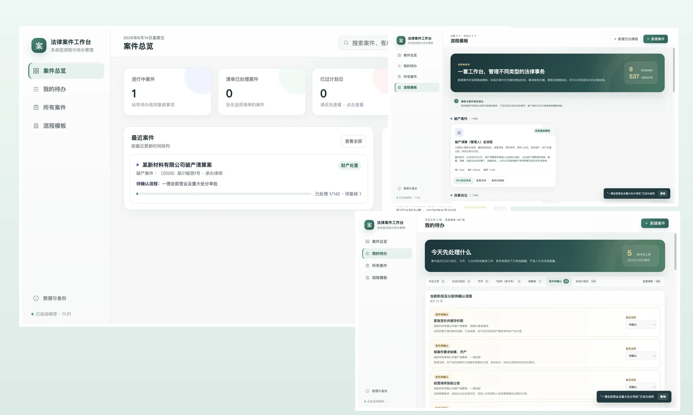
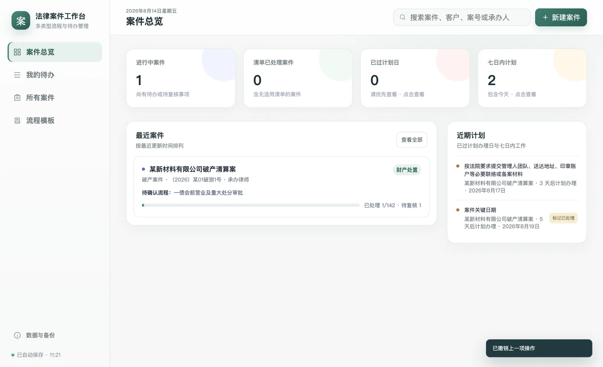
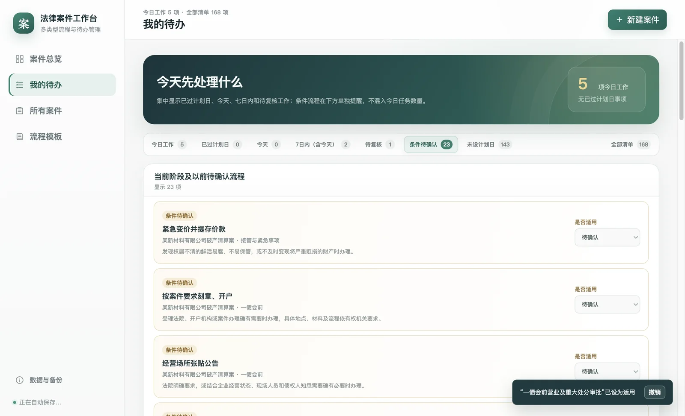
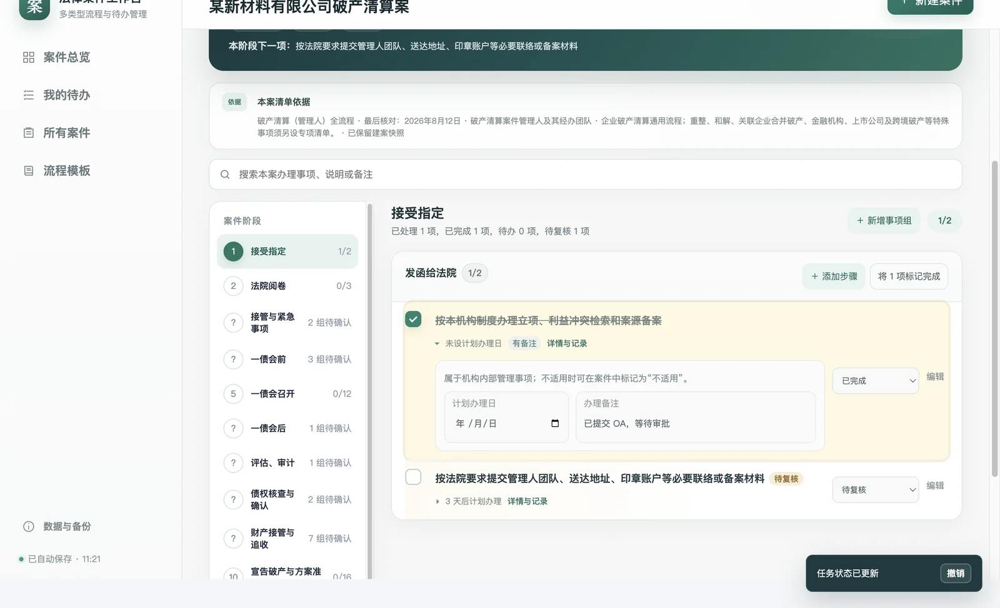
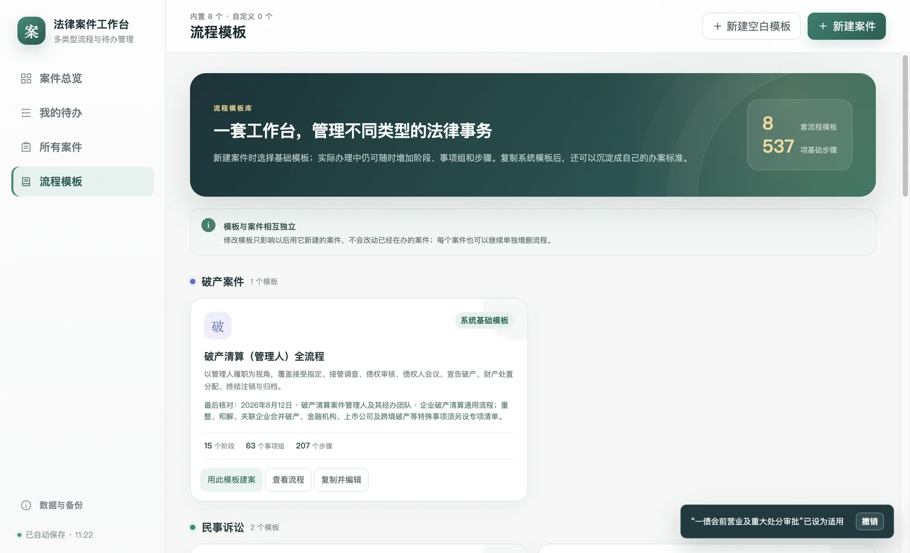
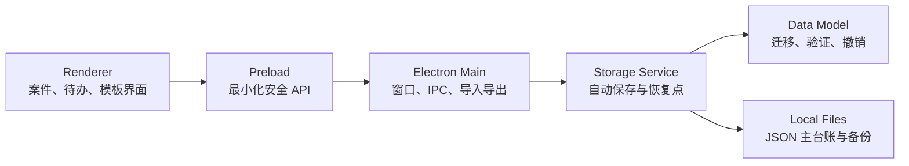

# 法律案件流程台账

> 面向普通律师的本地案件工作台：同时管理多个案件、跟进办理流程、聚合今日待办，并允许按实际案件随时调整步骤。



| 内置流程模板 | 阶段 | 事项组 | 基础步骤 |
| ---: | ---: | ---: | ---: |
| **8** | **64** | **142** | **537** |

法律案件流程台账是一个 Windows / macOS 本地桌面应用。它不要求用户学习项目管理软件：建案时选择办案模板，办理时勾选、排期、备注和复核，案件之间的进度和近期工作由系统自动汇总。

> 预览图中的“某新材料有限公司”、“（2026）某01破测1号”等均为自动化测试生成的虚构资料，不含真实客户或案件信息。

## 核心能力

- **多案件工作台**：按业务类型、承办人、办理阶段和关键词查找案件。
- **今日工作**：聚合已过计划日、今日、七日内、待复核和最近的未排期工作，条件流程单独提醒。
- **灵活流程**：案件内可增删阶段、事项组和步骤；系统模板可复制编辑，现有案件也可另存为个人模板。
- **明确状态**：支持待办理、已完成、不适用、非委托范围、已由他人完成和待复核。
- **本地可控**：自动保存、每日恢复点、完整台账备份、恢复前预检、损坏文件保全和案件清单导出。
- **容错操作**：任务与条件状态可撤销，删除模板、阶段、事项组或步骤后可恢复，案件先进入“最近删除”。

## 内置模板

| 业务类型 | 模板 | 阶段 | 步骤 |
| --- | --- | ---: | ---: |
| 破产案件 | 破产清算（管理人）全流程 | 15 | 207 |
| 民事诉讼 | 原告基础流程 | 8 | 51 |
| 民事诉讼 | 被告基础流程 | 8 | 50 |
| 刑事诉讼 | 辩护基础流程 | 8 | 57 |
| 行政诉讼 | 原告基础流程 | 8 | 50 |
| 执行案件 | 申请执行人基础流程 | 6 | 43 |
| 非诉项目 | 非诉专项基础流程 | 6 | 43 |
| 合同审查 | 合同审查基础流程 | 5 | 36 |

模板是建案时的工作底稿，建案后会保留独立快照。后续修改模板不会悄然改动正在办理的案件。

## 界面预览

| 案件总览 | 今日工作 |
| --- | --- |
|  |  |

| 案件流程 | 流程模板 |
| --- | --- |
|  |  |

## 安装与运行

发布包不放入 Git 历史，应从仓库的 **Releases** 页面下载。

| 平台 | 当前状态 | 使用方式 |
| --- | --- | --- |
| Windows x64 | 可用便携版，暂未代码签名 | 完整解压后双击 `LegalCaseTracker.exe` |
| macOS Apple 芯片 | 预览版，暂未 Developer ID 签名与公证 | 解压后打开“法律案件流程台账.app” |
| macOS Intel | 暂无发布包 | 尚未完成打包与验证 |
| Linux | 暂不支持 | 未进行产品验收 |

不要直接用浏览器打开 `src/index.html`；数据保存和文件导入导出依赖 Electron 桌面容器。

## 开发

环境建议：Node.js 22.12 或更高版本、pnpm 11。

```bash
pnpm install --frozen-lockfile
pnpm start
```

质量检查：

```bash
pnpm check
pnpm test
pnpm smoke
pnpm smoke:close
pnpm smoke:recovery
```

`smoke*` 脚本会真正启动 Electron，需要可用的图形环境。基础 CI 只执行 `check` 与 `test`。

打包：

```bash
pnpm package:win
pnpm package:mac
```

## 架构



渲染层开启上下文隔离，不直接获得 Node.js 权限；主进程仅向本地应用页面提供受限 IPC 能力。详见 [架构说明](docs/ARCHITECTURE.md)。

## 数据与隐私

- 本应用不设账号、不提供云同步，也不会自动上传案件资料。
- **主台账、恢复点、完整备份和导出清单都是可直接读取的明文文件，并非加密保险箱。**
- 存放真实案件资料时，请使用电脑登录密码、BitLocker 或 FileVault，并将备份保存在可信位置。
- 不要把真实台账、完整备份、案号或未脱敏截图提交到 Issue、Pull Request 或公开网盘。

更换电脑时，先在旧电脑导出“完整台账备份”，然后在新电脑进行恢复。Excel / CSV 案件清单只供查看统计，不能用来恢复台账。详见 [数据与隐私说明](docs/DATA-AND-PRIVACY.md)。

## 测试状态

v1.6.3 基线已通过：

- 27 项 `node:test` 自动测试。
- 主流程 Electron 操作验收。
- 立即关闭时的最后一次保存验收。
- 主台账损坏后的恢复验收。

GitHub Actions 会在提交和 Pull Request 上重新执行静态检查与单元测试。

## 法律声明

本项目及内置模板仅用于通用办案管理和工作提示，**不构成法律意见，也不能替代承办人的专业判断**。法律、司法解释、地方规则、法院要求和案件情况会变化；使用前必须核对现行有效规范、生效法律文书与具体期限。

## 参与开发

提交问题或代码前，请先阅读 [CONTRIBUTING.md](CONTRIBUTING.md) 和 [SECURITY.md](SECURITY.md)。所有公开测试、截图和问题复现必须使用虚构资料。

## 开源许可

本项目采用 [MIT License](LICENSE) 开源。内置法律流程仅作为通用办案管理示例，使用和再分发时仍应自行核对现行规范、适用范围及具体案件要求。
