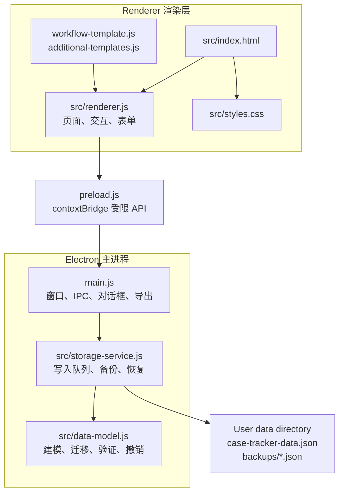
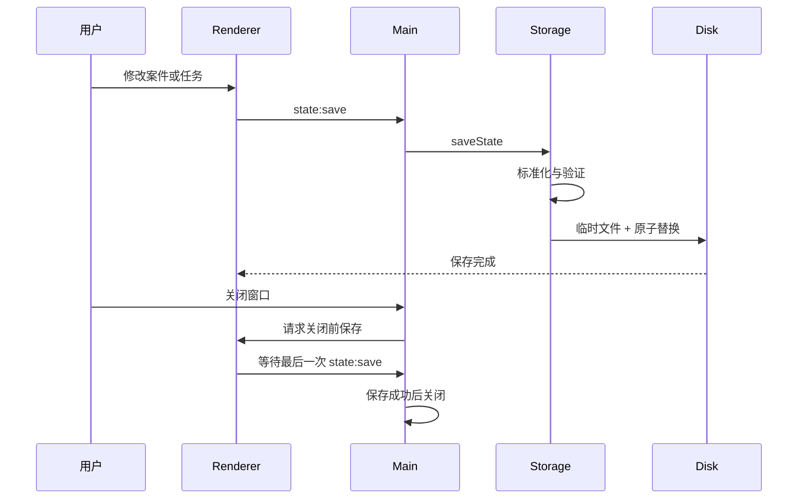

# 架构说明

## 目标

本应用采用单机 Electron 架构，核心取舍是：

1. 普通律师不需要配置数据库、账号或服务器。
2. 无网络时仍能办理案件并自动保存。
3. 模板是起点而不是强制流程，每个案件保留自己的快照。
4. 保存、恢复和迁移必须能被自动化验证。

## 进程与模块

### 渲染层

`src/renderer.js` 负责案件总览、待办、案件详情、模板中心和数据中心。它不直接访问文件系统，而是通过 `preload.js` 暴露的最小 API 发起请求。

### 预加载桥接

`preload.js` 是渲染层与主进程之间的边界。窗口开启 `contextIsolation`、关闭 `nodeIntegration` 并启用 Electron 沙箱，页面只能调用明确列出的 IPC 方法。

### 主进程

`main.js` 管理应用窗口、文件选择器、导入导出和退出保存。IPC 处理器会检查请求是否来自应用自身的本地页面，外部链接只允许通过系统浏览器打开 HTTPS 地址。

### 领域模型

`src/data-model.js` 是可在不启动 Electron 的情况下测试的纯 JavaScript 模块，负责：

- 案件、阶段、事项组和步骤的标准化。
- 历史数据版本迁移。
- 数据完整性与字段大小验证。
- 今日工作、进度和下一事项的派生计算。
- 可撤销操作和结构恢复。

### 存储服务

`src/storage-service.js` 将写入合并为有序队列，在落盘前验证完整状态，并管理：

- 主台账原子替换。
- 每日恢复点和总体积上限。
- 模式升级前恢复点。
- 损坏文件原样保全。
- 备份导入预检和短时效应用令牌。
- 旧版本机加密容器的兼容读取与迁移。

正常的新数据与备份是明文 JSON。旧加密兼容代码不表示当前数据会被加密，详见 [DATA-AND-PRIVACY.md](DATA-AND-PRIVACY.md)。

## 保存与退出时序

## 测试层次

- `tests/*.test.js`：模型和存储服务的快速自动化测试。
- `pnpm smoke`：启动真实 Electron 窗口，演练建案、待办、模板、编辑防丢失与恢复。
- `pnpm smoke:close`：验证刚修改就退出时仍会落盘。
- `pnpm smoke:recovery`：验证主台账损坏后的保全和恢复。
